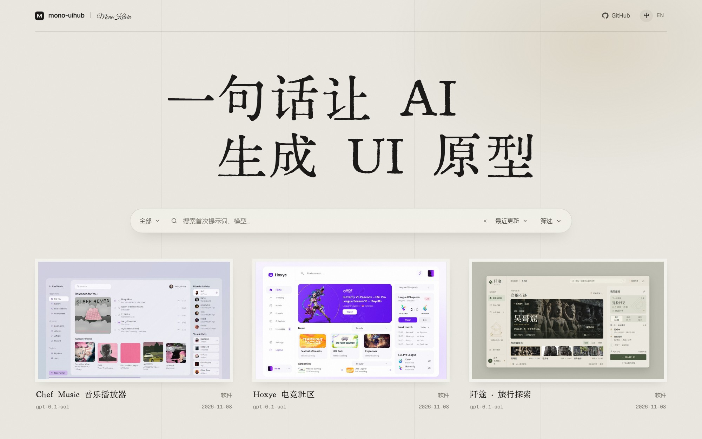
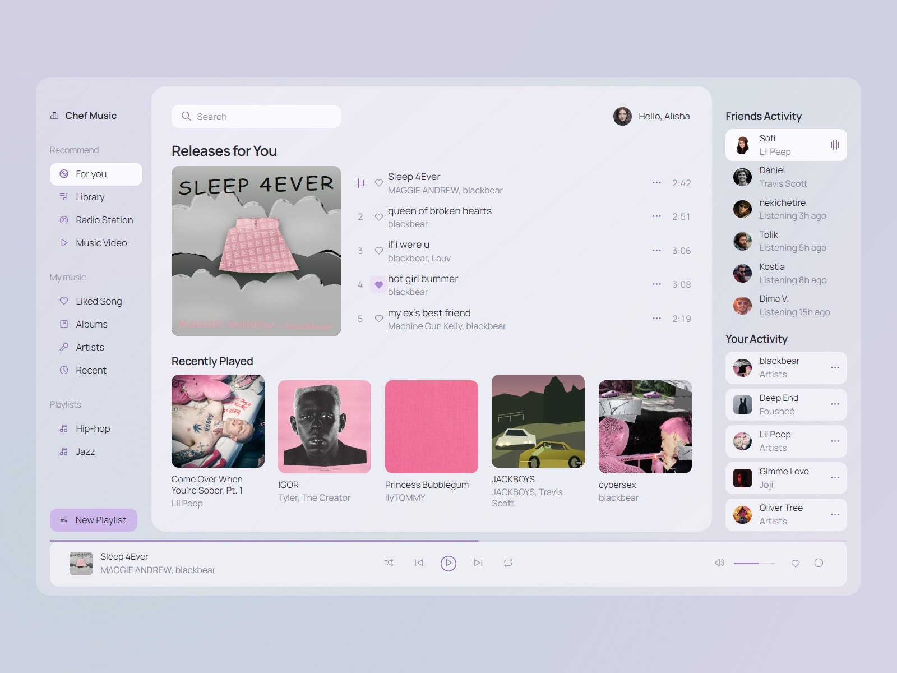
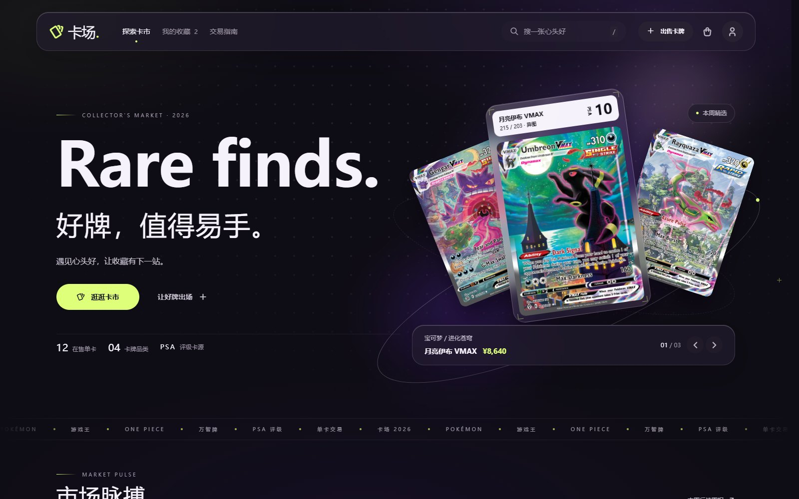
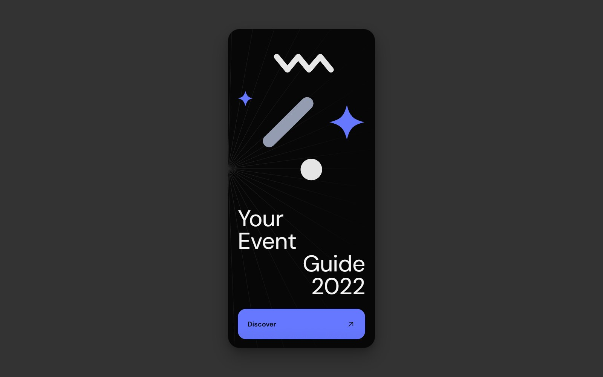

<div align="center">



[](https://github.com/MonoKelvin/mono-uihub)


# mono-uihub

[中文说明](README.zh.md)

</div>

A collection of AI-generated UI prototypes for websites, mobile apps, desktop software and components. Each prototype is a standalone HTML / CSS / JavaScript page you can open, inspect and edit. Interactions use local mock data, with no backend connection.

## Examples

<table>
  <tr>
    <td align="center" width="33%">
      <a href="ui/chef-music/"></a><br>
      <sub><b>Chef Music</b> — music player</sub>
    </td>
    <td align="center" width="33%">
      <a href="ui/card-market/"></a><br>
      <sub><b>卡场</b> — card-trading platform</sub>
    </td>
    <td align="center" width="33%">
      <a href="ui/event-guide/"></a><br>
      <sub><b>Event Guide</b> — event program</sub>
    </td>
  </tr>
</table>

Click an image for its source and screenshots. More pages are in [`ui/`](ui/).

## Usage

**View a prototype:** Open `index.html` in any page folder under `ui/`. No installation or build required.

**Run the gallery:** Search, filter and preview prototypes. Requires Node.js 22.12.0 or later.

```bash
cd site
npm install
npm run dev
```

**Generate a prototype:** Ask your coding agent to follow the [`mono-ui-prototype`](skills/mono-ui-prototype/SKILL.md) skill, with a brief or reference image. For example:

> Build a mechanical keyboard configurator with switch selection, keycap options and a live preview.

The skill defines the design process and delivery checks. Colors, typography and layout are chosen for the brief; you can request changes afterward.

## Tools

- [`resource-getter`](tools/resource-getter/README.md): Fetch illustrations, transparent PNGs and photos; download locally when the source is slow.
- [`image-forge`](tools/image-forge/README.md): Generate transparent PNGs with prompt additions to reduce noise and unwanted texture.

## License

Code is licensed under [MIT](LICENSE). Third-party images, fonts and other assets retain their own licenses.
