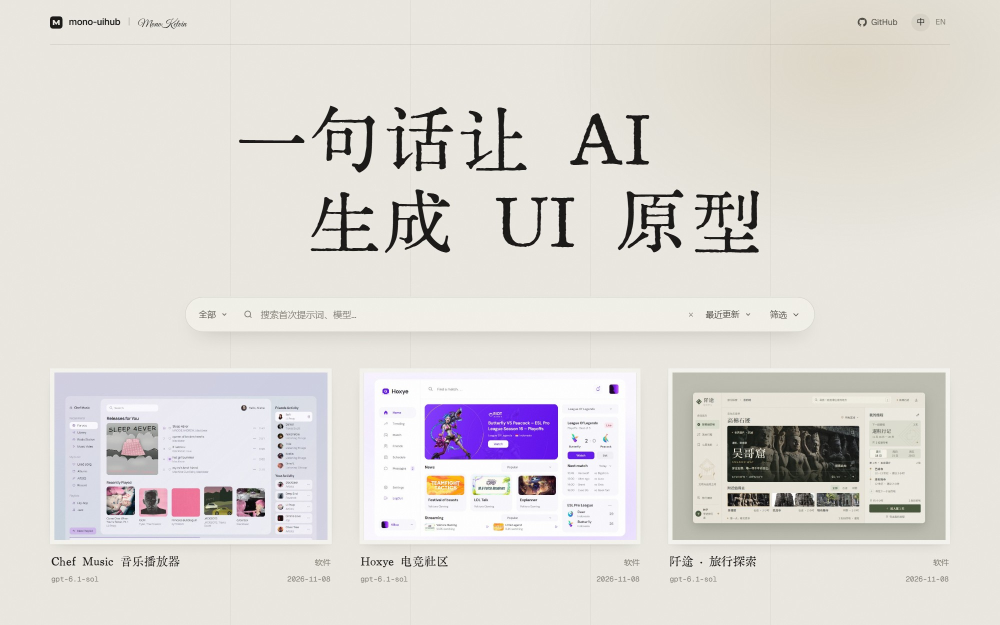
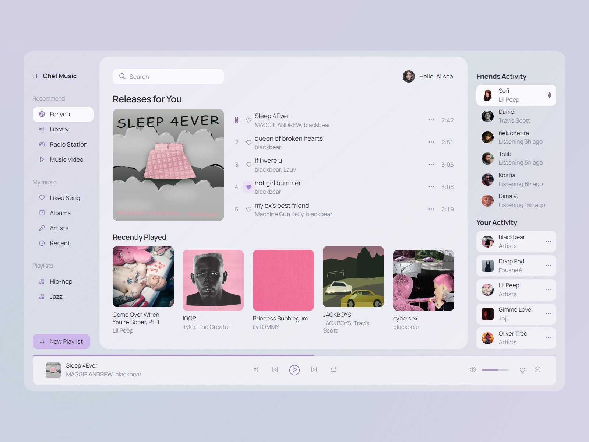
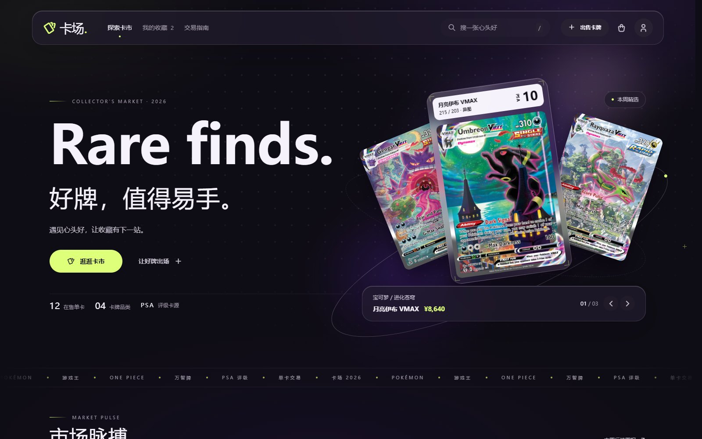
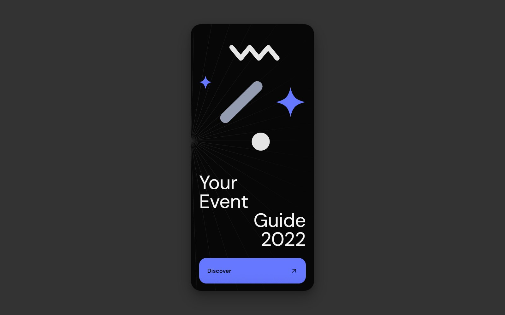

<div align="center">



[](https://github.com/MonoKelvin/mono-uihub)


# mono-uihub

[English](README.md)

</div>

一个用 AI 制作的 UI 原型库，包含网页、手机 App、桌面软件和组件。每个原型都是独立的 HTML / CSS / JavaScript 页面，可直接打开、查看源码或修改。交互使用本地模拟数据，不连接后端。

## 页面示例

<table>
  <tr>
    <td align="center" width="33%">
      <a href="ui/chef-music/"></a><br>
      <sub><b>Chef Music</b> · 音乐播放器</sub>
    </td>
    <td align="center" width="33%">
      <a href="ui/card-market/"></a><br>
      <sub><b>卡场</b> · 在线卡牌交易</sub>
    </td>
    <td align="center" width="33%">
      <a href="ui/event-guide/"></a><br>
      <sub><b>Event Guide</b> · 活动手册</sub>
    </td>
  </tr>
</table>

点击图片查看源码和截图，更多页面见 [`ui/`](ui/)。

## 使用

**查看原型**：打开 `ui/` 下任意页面目录中的 `index.html`，无需安装依赖或构建。

**启动画廊**：支持搜索、筛选和原型预览，需要 Node.js 22.12.0 或更高版本。

```bash
cd site
npm install
npm run dev
```

**生成原型**：让编码助手按 [`mono-ui-prototype`](skills/mono-ui-prototype/SKILL.md) 技能制作页面，附上需求或参考图。例如：

> 做一个机械键盘定制页，支持选择轴体、切换键帽和实时预览。

技能规定了设计流程和交付检查。配色、字体、布局按需求确定，生成后可以继续提出修改意见。

## 工具

- [`resource-getter`](tools/resource-getter/README.md)：获取插画、透明 PNG 和照片，源站较慢时下载到本地。
- [`image-forge`](tools/image-forge/README.md)：按需生成透明 PNG，自动补充减少噪点和杂乱纹理的提示词。

## 协议

代码采用 [MIT](LICENSE) 协议。第三方图片、字体等素材遵循各自的许可。
